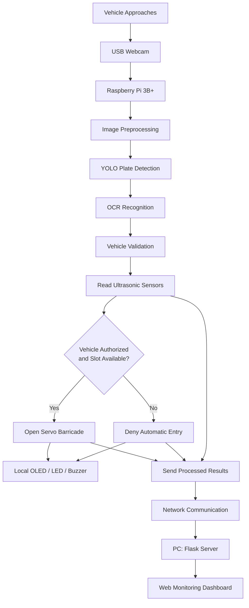

# 🚗 AI-Assisted HSRP Recognition & Smart Campus Parking

<p align="center">
  <strong>An Edge-AI Smart Parking and Vehicle Access Control System</strong>
  <br>
  Built with Raspberry Pi, YOLO, OCR, Ultrasonic Sensors, and Flask
</p>

<p align="center">
  
  
  
  
  
</p>

---

## 📌 Overview

**AI-Assisted HSRP Recognition and Smart Campus Parking Monitoring System** is an intelligent parking solution designed to automate vehicle identification, parking-slot monitoring, and entry authorization in campus environments.

The system uses a USB webcam and a YOLO-based computer vision model to detect Indian High Security Registration Plates (HSRPs). OCR extracts the registration number, which is checked against the project's configured vehicle-validation source. Ultrasonic sensors monitor parking occupancy, and a servo-controlled barricade manages authorized entry.

The key design principle is **edge AI**: all operational processing and hardware control take place on the Raspberry Pi. A separate PC hosts the Flask server and web dashboard for monitoring.

## ✨ Key Features

- 🔍 **Automatic Number Plate Detection** — Detects vehicle registration plates using a YOLO-based model.
- 🔤 **OCR-Based Recognition** — Extracts registration characters from detected plate images.
- 🧠 **Local Edge-AI Processing** — Runs AI inference and OCR on the Raspberry Pi instead of relying on the PC for image processing.
- 🅿️ **Smart Parking Monitoring** — Uses ultrasonic sensors to determine parking-slot occupancy.
- 🚧 **Automated Entry Control** — Controls an SG90 servo motor to operate the parking barricade according to the authorization logic.
- 🖥️ **Web-Based Monitoring** — Displays supported vehicle-recognition results and system readings through a Flask dashboard hosted on a PC.
- 💡 **Local Status Feedback** — Uses an OLED display, LEDs, and a buzzer for status indications where integrated.
- 🔗 **Network Communication** — Sends processed information and system-status updates from the Raspberry Pi to the PC.

## 🏗️ System Architecture



> **Architecture rule:** The Raspberry Pi performs AI inference, OCR, sensor processing, entry decisions, and physical hardware control. The PC hosts only the Flask server and dashboard. The diagram represents the intended workflow; actual implementation and error-handling behavior should be verified against the project code.

## ⚙️ Hardware Components

| Component | Purpose |
|---|---|
| Raspberry Pi 3 Model B+ (1 GB RAM) | Edge computing and hardware control |
| USB Webcam | Vehicle image capture |
| HC-SR04 Ultrasonic Sensors | Parking-slot occupancy detection |
| SG90 Servo Motor | Parking barricade actuation |
| 0.91-inch OLED Display | Local status messages |
| LEDs and Resistors | Visual status indication |
| Buzzer | Audible status feedback |
| PC | Flask server and monitoring dashboard |

The design targets four parking slots. Confirm the final sensor wiring and integration before treating all four slots as fully operational.

## 💻 Software and Technologies

- **Python** — Application logic and hardware integration
- **YOLO** — Vehicle registration plate detection
- **OCR** — Registration character extraction
- **OpenCV** — Image processing, if used by the implemented pipeline
- **Flask** — PC-hosted web server and dashboard
- **Raspberry Pi GPIO libraries** — Sensor and actuator interaction
- **HTML and CSS** — Web dashboard interface

Exact library versions and dependencies should be documented from the actual project environment.

## 🔄 How It Works

1. **Image capture:** The USB webcam captures a vehicle image at the parking entrance.
2. **Plate detection:** The Raspberry Pi runs the YOLO-based model locally to locate the registration plate.
3. **Character recognition:** OCR processes the detected plate region and extracts the registration number.
4. **Vehicle validation:** The extracted number is checked against the configured validation source.
5. **Parking assessment:** The Raspberry Pi reads the ultrasonic sensors to determine slot occupancy.
6. **Entry decision:** The local application determines whether the vehicle is authorized and parking is available.
7. **Barricade control:** The Raspberry Pi operates the servo according to the implemented entry-control logic.
8. **Local feedback:** The OLED, LEDs, and buzzer provide supported status indications.
9. **Dashboard update:** The Raspberry Pi sends processed results and relevant sensor readings to the Flask server on the PC.

Unreadable plates, unauthorized vehicles, and full-parking conditions should not receive automatic entry authorization.

## 📂 Repository Structure

```text
hsrp-smart-campus-parking/
│
├── ocr/
│   └── ocr.py
│
├── static/
│   └── style.css
│
├── templates/
│   ├── admin_login.html
│   ├── dashboard.html
│   └── register.html
│
├── ocr_test.py
├── server.py
├── webcam_alpr_authorize.py
├── webcam_alpr_test.py
├── START_DASHBOARD.bat
├── README.md
└── .gitignore
```

*Note: This is a simplified overview of the current repository. Additional files include older server versions and backup scripts. The Raspberry Pi application may be maintained separately.*

## 🚀 Getting Started

### Prerequisites

- A Windows PC for the Flask dashboard
- A Raspberry Pi 3 Model B+ for edge processing
- Python installed on the relevant device
- A USB webcam and the required hardware
- The required Python libraries and model files
- Network connectivity between the Raspberry Pi and PC

### 1. Clone the repository

```bash
git clone https://github.com/anmolagarwal-commits/hsrp-smart-campus-parking.git
cd hsrp-smart-campus-parking
```

### 2. Set up a Python environment

On Windows:

```bash
python -m venv .venv
.venv\Scripts\activate
```

On Raspberry Pi OS:

```bash
python3 -m venv .venv
source .venv/bin/activate
```

### 3. Install dependencies

Install the dependencies required by the actual application and model. If a `requirements.txt` file is added to this repository, use:

```bash
pip install -r requirements.txt
```

The current repository does not yet include a verified `requirements.txt`; create one from the tested environment before relying on this command.

### 4. Start the Flask dashboard

On the PC, install the required server dependencies and configure the dashboard settings. The project includes `START_DASHBOARD.bat`, which may be used after verifying its contents and configuration.

Alternatively, if `server.py` is the correct Flask entry point, run:

```bash
python server.py
```

Configure the server to listen on the appropriate network interface if the Raspberry Pi must connect to it. Do not expose the dashboard publicly without appropriate authentication and network security.

### 5. Configure the Raspberry Pi

Copy or clone the Raspberry Pi application onto the Pi and configure:

- The PC's reachable IP address and Flask server port
- The YOLO model path and OCR dependencies
- GPIO assignments for sensors and servo
- OLED and other peripheral settings
- Network communication settings

Run the Pi-side application using its actual entry-point script. Do not run the PC's Flask server as a replacement for the Raspberry Pi's AI and hardware-control application.

**Important:** File paths, dependencies, GPIO pins, and server addresses must match your actual setup.

## 📊 Results and Evaluation

Evaluate the system using reproducible tests rather than assumed performance figures.

| Evaluation area | Measurement |
|---|---|
| Plate detection | Correct detections and missed detections |
| OCR | Exact registration-number matches |
| Processing performance | Inference and end-to-end latency |
| Parking monitoring | Sensor readings and occupancy correctness |
| Access control | Correct authorization and rejection decisions |
| Hardware control | Barricade operation during test cases |
| Dashboard communication | Successful status updates and latency |

Experimental values should be added only after collecting and verifying the measurements. No accuracy, latency, or reliability figures are claimed in this README.

## 🔐 Security and Privacy

- Do not commit passwords, API keys, tokens, or private configuration files.
- Keep real vehicle registration records and local database files out of public repositories.
- Use anonymized test data when sharing screenshots or logs.
- Secure dashboard access and network communication.
- Review all source files before publishing the repository publicly.

## 🛠️ Future Improvements

- Evaluate plate recognition under different lighting and viewing angles.
- Measure end-to-end latency and resource usage on the Raspberry Pi.
- Improve OCR error handling and uncertain-recognition handling.
- Add comprehensive sensor and access-control test reports.
- Improve dashboard visualization and historical parking analytics.
- Add secure communication and more robust system monitoring.

These are potential improvements, not claims that the features have already been implemented.

## 👨‍💻 Project Information

**Developers:** Anmol Agarwal and Lakshya Gupta  
**Department:** Computer Science and Engineering (Internet of Things)  
**Institution:** Noida Institute of Engineering and Technology (NIET), Greater Noida, India

## ⭐ Support

If you find this project interesting, consider starring the repository and sharing feedback.

**Repository:** [anmolagarwal-commits/hsrp-smart-campus-parking](https://github.com/anmolagarwal-commits/hsrp-smart-campus-parking)

---

<p align="center">
  <em>Exploring Edge AI, IoT, computer vision, and intelligent campus infrastructure.</em>
</p>
